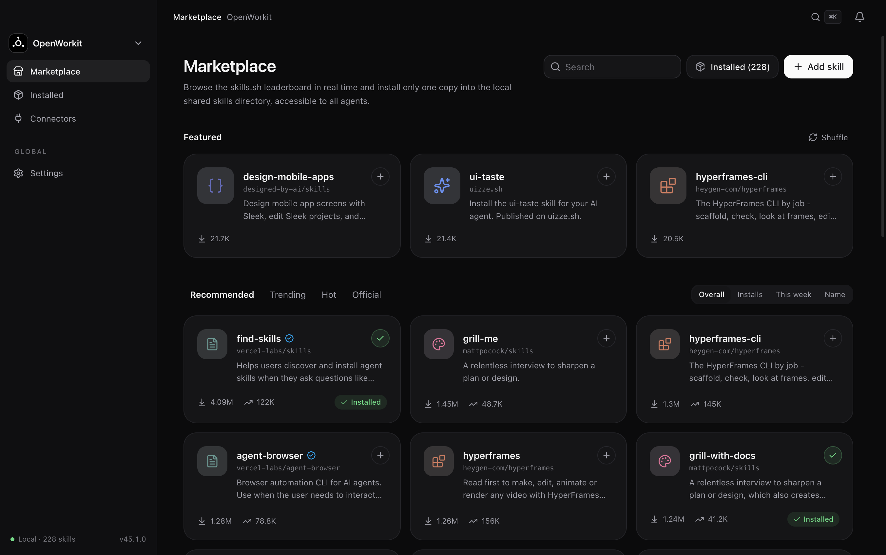

# OpenWorkit

A macOS desktop client that manages **skills** and **MCP connectors** for every AI coding / work agent on your machine from one place — instead of configuring each agent separately.



## What it solves

The same `SKILL.md` tends to end up copied into `~/.claude/skills`, `~/.codex/skills`, `~/.pi/agent/skills` and a dozen other places, so one edit becomes twelve. MCP server configuration is just as scattered, in a different format per agent (`settings.json` / `mcp.json` / `config.toml`). OpenWorkit collapses that into a single interface:

- **Installed** — scans 16 agent skill directories and groups them per directory, reading frontmatter metadata, enabled state and symlink targets; a drawer shows the `SKILL.md` body, with enable/disable, delete and Reveal in Finder in place. Toggling renames the directory `foo` ↔ `foo.disabled`, so nothing is ever deleted.
- **Marketplace** — live [skills.sh](https://www.skills.sh) leaderboard (Recommended / Trending / Hot / Official) with search, per-skill descriptions and install commands, one-click install into the shared directory you picked, plus import from a local folder. Skill files come through the jsDelivr mirror, repository metadata through the GitHub API.
- **Connectors** — parses each agent's MCP configuration, groups servers by transport (stdio / http / sse), separates user scope from project scope, and jumps to the config file.
- **Settings** — theme (system / light / dark), language (Chinese / English), compact mode, delete confirmation, auto-scan, install target, skill directory add/remove/toggle, environment and diagnostics.

The UI is bilingual (zh / en) with light and dark themes; every screen is captured in [screenshots/](screenshots/).

## Agents detected

Skill directories and MCP configs are probed at these paths. An agent whose directory does not exist simply does not appear in the UI (TRAE's connector config resolves to `trae-work-cn`):

| Agent | Skill directory |
|---|---|
| Agents (shared) | `~/.agents/skills` |
| Claude | `~/.claude/skills` |
| Qoder CN | `~/.qoder-cn/skills` |
| Codex | `~/.codex/skills` |
| Gemini CLI | `~/.gemini/skills` |
| OpenCode | `~/.config/opencode/skills` |
| Pi | `~/.pi/agent/skills` |
| TRAE / TRAE Work | `~/.trae/skills`, `~/.trae-cn/skills` |
| Kimi Work / Kimi Code | `~/.kimi-work/skills`, `~/.kimi-code/skills` |
| QwenWork / QwenWork CN | `~/.qwenwork/skills`, `~/.qwenworkcn/skills` |
| WorkBuddy | `~/.workbuddy/skills` |
| Doubao | `~/Doubao/skills` |
| ZCode | `~/.zcode/skills` |

Brand marks come from [LobeHub Icons](https://lobehub.com/icons) (MIT).

## Keyboard shortcuts

`⌘K` focus search · `⌘R` rescan · `⌘1` marketplace · `⌘2` installed · `⌘3` connectors · `⌘4` / `⌘,` settings.

## Stack

Electron 45 · React 19 · TypeScript 7 · Vite 8 ([electron-vite](https://electron-vite.org) 6) · Tailwind CSS 4 · [Base UI](https://base-ui.com) 1.9 (wrapped through shadcn, see [src/renderer/src/components/ui](src/renderer/src/components/ui)) · i18next · lucide-react · sonner.

The process boundary is deliberately thin: the main process only scans files and fetches over the network, exposing the `Api` interface declared in [src/shared/api.ts](src/shared/api.ts) to the renderer through preload. Windows run with `sandbox: true`, `contextIsolation: true` and `nodeIntegration: false`, so the renderer has no Node access at all.

## Development

```bash
pnpm install      # also runs postinstall (see below)
pnpm dev          # dev instance with renderer hot reload
pnpm typecheck    # tsc --noEmit
pnpm build        # emits out/{main,preload,renderer}
pnpm smoke        # launches the built app headless and drives it
pnpm screenshots  # regenerates the images in screenshots/
pnpm app-icon     # re-rasterizes the app icon from logo.svg
```

Requires Node 24 and macOS (verified locally on Node v24.18 / Electron 45.1; the Dock icon and bundle-name handling are darwin-only paths).

**If `pnpm dev` dies with `Cannot read properties of undefined (reading 'setName')`**: `ELECTRON_RUN_AS_NODE` is exported in your environment, which makes Electron start as plain Node. Run `unset ELECTRON_RUN_AS_NODE`.

**What postinstall does**: the name macOS shows in the Dock and ⌘Tab comes from the `Info.plist` of the running bundle, which `app.setName()` cannot reach, so [scripts/prepare-dev-app.mjs](scripts/prepare-dev-app.mjs) rewrites `CFBundleName` / `CFBundleDisplayName` to `OpenWorkit` and the bundle id to `com.openworkit.app` on the dev bundle at `node_modules/electron/dist/Electron.app`. It only touches node_modules, is idempotent, and is re-applied on every install.

**App icon**: [src/main/app-icon.png](src/main/app-icon.png) is rasterized from [src/renderer/src/components/logo.svg](src/renderer/src/components/logo.svg) by [scripts/make-icon.mjs](scripts/make-icon.mjs) (Electron's `nativeImage` does not read SVG). Re-run `pnpm app-icon` after changing the logo.

## Verification

`pnpm smoke` drives the built app through Playwright's Electron launcher. It seeds a temporary HOME and a temporary userData with skill directories and each agent's MCP config, then asserts end-to-end behaviour: scan counts and ordering, the `.disabled` rename on toggle, install and duplicate rejection, refusal to read outside configured directories, deletion, symlink detection, parsing of six MCP config formats, marketplace rendering, plus dialog / tooltip / menu / sheet / select interaction and settings persistence (55 assertions).

It runs `out/`, so build before smoke-testing main-process changes. Only one instance at a time: when instances share a userData directory, Electron's single-instance lock hands the second launch to the older build, and you end up testing code you no longer have.

## Layout

```
src/
  main/        main process: settings / skills / connectors / market scanning and IPC
  preload/     contextBridge, exposes window.api
  shared/      the Api interface and every shared type
  renderer/src
    pages/                marketplace, installed, connectors, settings (per section)
    components/app        shell: sidebar, topbar, page primitives, agent marks
    components/ui         Base UI wrappers (button / dialog / sheet / select / …)
    providers/            settings and skills state and subscriptions
    lib/                  router, agent directory identification, utilities
    i18n/locales/         zh.ts / en.ts
scripts/       smoke, screenshots, icon and dev-bundle handling
.migration/    per-component Radix UI → Base UI migration records
```

## Where data lives

- Settings: `~/Library/Application Support/OpenWorkit/settings.json` (the dev instance uses the same path; the `OPENWORK_USER_DATA` environment variable relocates it, which is how the automated runs stay isolated).
- Skills: always written to the real skill directories on disk. OpenWorkit is another view onto them — no copies, no reformatting.
- Network: GET requests to `www.skills.sh`, `api.github.com`, `data.jsdelivr.com`, `cdn.jsdelivr.net` / `gcore.jsdelivr.net` only. Nothing about your machine is uploaded.

## Status and next

There is no packaging or distribution toolchain installed yet — `dev` and `build` only, no `.dmg` pipeline. The next piece in progress is **browsing and full-text search across agent session history**: a local `node:sqlite` + FTS5 index that stores tokens and byte offsets and never copies message bodies, with a per-agent adapter reading each agent's own session store.
